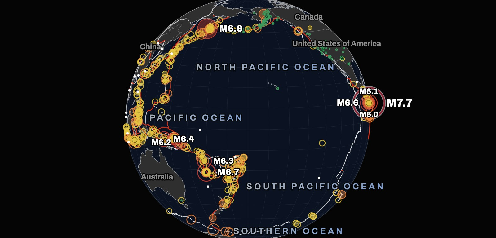
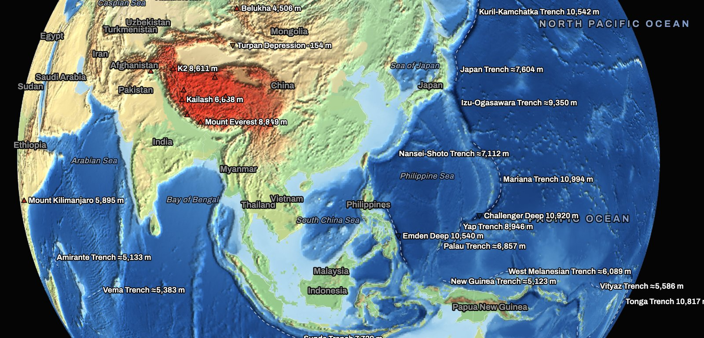
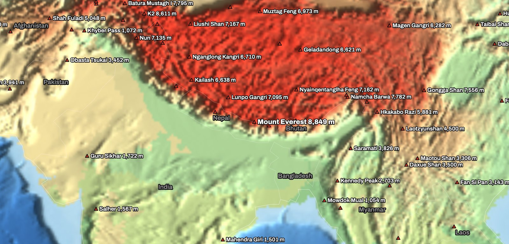
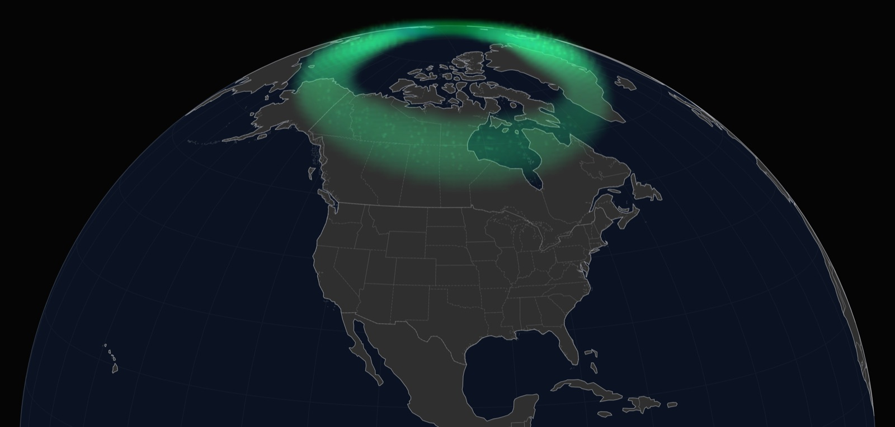

  

<h1 align="center">TerraGlobe</h1>

  <b>The world's live and reference data on one interactive globe.</b> 
  <a href="https://terraglobe.org"><b>terraglobe.org</b></a>
  &nbsp;·&nbsp;
  <a href="https://github.com/krstp/terraglobe/issues/new/choose">Report a problem or suggest an idea</a>

  
   Earthquakes around the Pacific "Ring of Fire" - bigger and redder circles are stronger quakes, lines are tectonic plate boundaries.

---

## What is TerraGlobe?

TerraGlobe is a 3D globe that runs in your web browser - on a phone, tablet or computer, with nothing to install and no account. Turn on a layer from the menus at the top, then click any country, city or sea to open a card with facts, figures and today's news.

Every layer names its source and the date the data was last updated in its legend on the map. Where data is missing, the globe says "no data" - it never guesses.

## What you can see

| | |
|---|---|
| **Weather** | Temperature, wind, rain, climate by month, tropical storms, weather warnings, northern and southern lights |
| **Earth** | Earthquakes, tectonic plates, active fires, terrain and ocean floor, day and night, Sun and Moon, city lights |
| **News** | Which countries the world is talking about right now, and their top stories |
| **War zones** | Conflicts by intensity, armed groups, nuclear warheads |
| **Politics** | Who governs, regime type, corruption index, international organisations, foreign influence |
| **Economy** | GDP, debt, trade, wages, taxes, health spending, unemployment |
| **People** | Population, births, life expectancy, migration and refugees |
| **Alliances & trade** | Military alliances, blocs, trade agreements, trade partners, shipping, rail, road and air routes |
| **Energy & commodities** | Power plants, nuclear plants, dams, pipelines, mines; who produces and exports what |
| **Air & sea** | Aircraft, ships, satellites and space stations |

## A few views

<table>
  <tr>
    <td width="50%"></td>
    <td width="50%"></td>
  </tr>
  <tr>
    <td><b>Terrain & ocean floor</b> - from Mount Everest to the Mariana Trench.</td>
    <td><b>The Himalayas up close</b> - peaks with their heights.</td>
  </tr>
  <tr>
    <td colspan="2"></td>
  </tr>
  <tr>
    <td colspan="2"><b>Northern lights - live.</b> Where the aurora is likely to be seen right now, updated every 10 minutes.</td>
  </tr>
</table>

## Found a problem? Have an idea?

This page is the public place to tell us. **[Open a new issue](https://github.com/krstp/terraglobe/issues/new/choose)** and pick one of:

- 🐞 **Something doesn't work** - a button, a layer, a card, or the page on your device.
- 📊 **Wrong or missing data** - a number, a name or a place on the map looks wrong.
- 💡 **Idea** - a layer, a source or a feature you would like to see.

Please look through the [open issues](https://github.com/krstp/terraglobe/issues) first - someone may have reported it already. A 👍 on an existing issue helps us see what matters most.

You need a free GitHub account to post. Issues here are **public**, so please don't include personal details. If you prefer not to post publicly, the contact address is in the **Privacy** dialog on [terraglobe.org](https://terraglobe.org/#privacy).

## Using TerraGlobe

- **Education** (schools, universities, students, teachers, researchers): free.
- **Business or private-interest use**: needs a paid licence - get in touch via the contact address on the site.
- **Citing**: credit "TerraGlobe (terraglobe.org)" together with the source named in the layer's legend. Details: [How to cite](https://terraglobe.org/#cite).
- **Privacy**: no cookies, no analytics, no ads. Details: [Privacy](https://terraglobe.org/#privacy).

## About this repository

This repository holds **no source code** - TerraGlobe is closed source. It is here for the issue tracker and this page. See [LICENSE](LICENSE).

Screenshots show data from the U.S. Geological Survey (earthquakes), Bird 2003 / PB2002 (plate boundaries), NOAA ETOPO 2022 and GEBCO (terrain and ocean floor), Beck et al. 2023 (climate zones), Natural Earth (borders, peaks) and NOAA SWPC (aurora).
